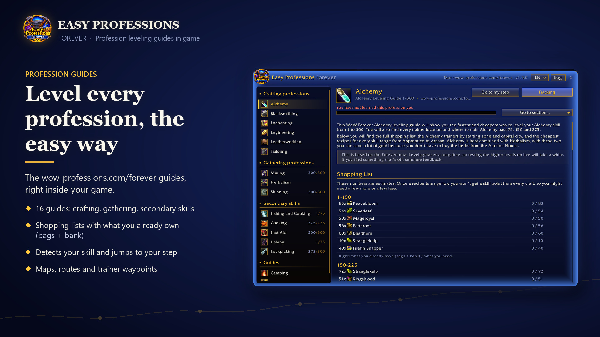
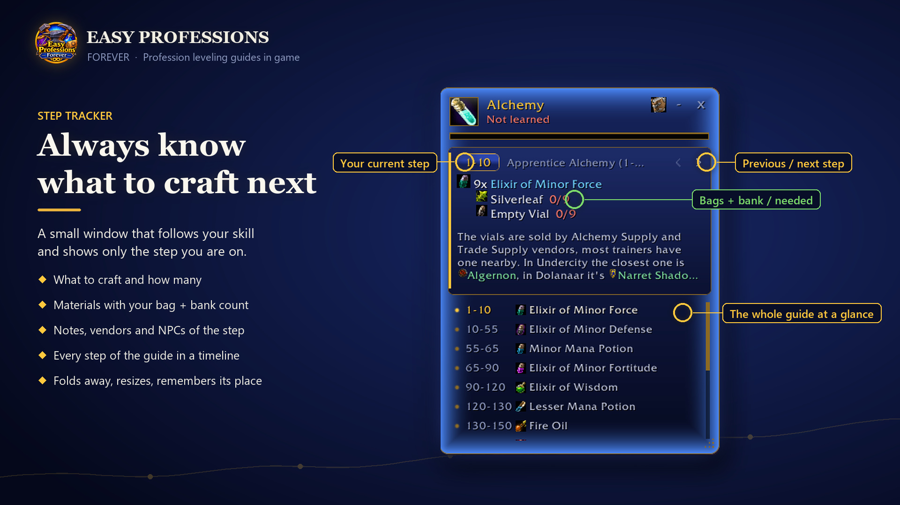
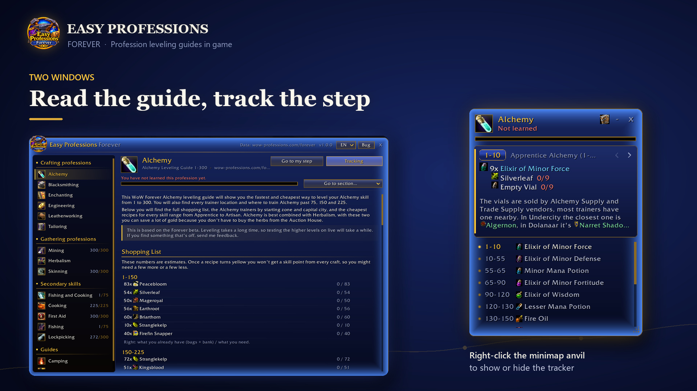
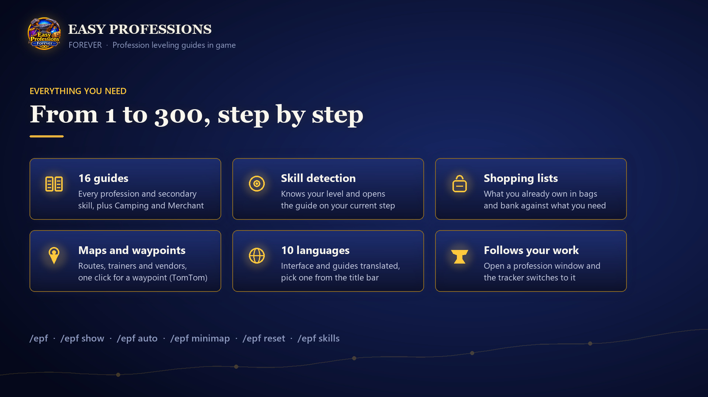

  

<h1 align="center">Easy Professions (Forever)</h1>

  <strong>Every profession leveling guide of wow-professions.com/forever, in game.</strong> 
  <em>Tous les guides de montée des métiers de wow-professions.com/forever, en jeu.</em>

  <a href="#english">English</a> · <a href="#français">Français</a>

  

## English

No more alt-tabbing to a website while you level a profession. Easy Professions brings the WoW Forever guides of wow-professions.com into the game: a small tracker shows the step you are on, and a big window holds every guide.

### Features

- **Tracker:** a small window with your current step, what to craft, the materials you have and the ones you still need. It follows your skill and moves to the next step on its own.
- **Guide window:** every guide in full, with sections, tables, shopping lists, trainers and recipe sources. Jump to your step or to any section in one click.
- **16 guides:** Alchemy, Blacksmithing, Enchanting, Engineering, Leatherworking, Tailoring, Mining, Herbalism, Skinning, Cooking, First Aid, Fishing, Lockpicking, Fishing and Cooking, Camping and Merchant.
- **Shopping list:** each material shows what you already have (bags and bank) against what you need.
- **Real links:** items, recipes and quests show their tooltip on hover, and map locations place a waypoint (TomTom, or the game's own map pin).
- **Skill detection:** your professions and skill levels are read from the game, and the tracker can follow the profession window you open.
- **Two themes:** Forever, the add-on's own animated skin, or Blizzard Forever, the game's own frames on a parchment page.
- **Resizable windows:** drag the bottom-right corner of the tracker or of the guide window.
- **Ten languages:** English, French, German, Spanish, Italian, Portuguese, Russian, Korean, Simplified Chinese and Traditional Chinese, for the interface and for the guides. The add-on follows your game language, or you can pick another one in the menu at the top of the window.

### Screenshots

    
    
  

### Installation

Copy the `Easy_Professions_Forever` folder into `Interface\AddOns`, then restart the game.

### Commands

| Command | Result |
|---|---|
| `/epf` | Open or close the guide window |
| `/epf show` | Open or close the tracker |
| `/epf auto` | Follow the profession window you open (on/off) |
| `/epf minimap` | Show or hide the minimap button |
| `/epf reset` | Put both windows back in the middle of the screen |

### Minimap button

| Action | Result |
|---|---|
| Left-click | Open or close the guide window |
| Right-click | Open or close the tracker |
| Drag | Move the button around the minimap |

## Français

Plus besoin de passer sur un site pendant que vous montez un métier. Easy Professions amène en jeu les guides WoW Forever de wow-professions.com : une petite fenêtre de suivi affiche l'étape en cours, et une grande fenêtre contient tous les guides.

### Fonctionnalités

- **Suivi :** une petite fenêtre avec l'étape en cours, ce qu'il faut fabriquer, les composants que vous avez et ceux qu'il vous manque. Elle suit votre niveau et passe seule à l'étape suivante.
- **Fenêtre des guides :** chaque guide en entier, avec les sections, les tableaux, les listes de courses, les maîtres et la provenance des recettes. Allez à votre étape ou à n'importe quelle section en un clic.
- **16 guides :** Alchimie, Forge, Enchantement, Ingénierie, Travail du cuir, Couture, Minage, Herboristerie, Dépeçage, Cuisine, Secourisme, Pêche, Crochetage, Pêche et Cuisine, Camping et Marchand.
- **Liste de courses :** chaque composant affiche ce que vous avez déjà (sacs et banque) face à ce qu'il faut.
- **Vrais liens :** les objets, recettes et quêtes affichent leur infobulle au survol, et les positions sur la carte placent un repère (TomTom, ou le repère de la carte du jeu).
- **Détection des métiers :** vos métiers et leur niveau sont lus dans le jeu, et le suivi peut suivre la fenêtre de métier que vous ouvrez.
- **Deux thèmes :** Forever, le style animé de l'add-on, ou Blizzard Forever, les cadres du jeu sur une page de parchemin.
- **Fenêtres redimensionnables :** tirez le coin en bas à droite du suivi ou de la fenêtre des guides.
- **Dix langues :** anglais, français, allemand, espagnol, italien, portugais, russe, coréen, chinois simplifié et chinois traditionnel, pour l'interface et pour les guides. L'add-on suit la langue du jeu, ou vous pouvez en choisir une autre dans le menu en haut de la fenêtre.

### Installation

Copiez le dossier `Easy_Professions_Forever` dans `Interface\AddOns`, puis relancez le jeu.

### Commandes

| Commande | Résultat |
|---|---|
| `/epf` | Ouvrir ou fermer la fenêtre des guides |
| `/epf show` | Ouvrir ou fermer le suivi |
| `/epf auto` | Suivre la fenêtre de métier ouverte (oui/non) |
| `/epf minimap` | Afficher ou cacher le bouton de la minicarte |
| `/epf reset` | Remettre les deux fenêtres au milieu de l'écran |

### Bouton de la minicarte

| Action | Résultat |
|---|---|
| Clic gauche | Ouvrir ou fermer la fenêtre des guides |
| Clic droit | Ouvrir ou fermer le suivi |
| Glisser | Déplacer le bouton autour de la minicarte |

## Credits / Crédits

Guides: [wow-professions.com/forever](https://www.wow-professions.com/forever).

## Report a bug / Signaler un bug

Use the **Bug** button at the top of the guide window to copy the link of the Discord server. 
Utilisez le bouton **Bug** en haut de la fenêtre des guides pour copier le lien du serveur Discord.
